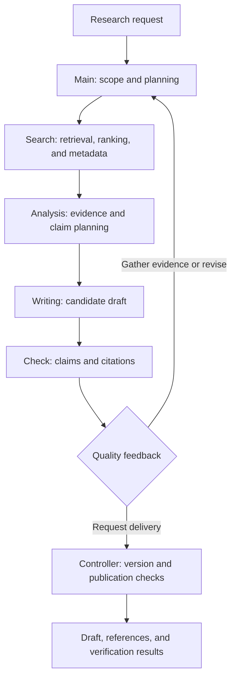

<div align="center">

# ResearchReview-Agent

**Turn a research question into a literature review grounded in evidence.**

Multi-source search · Structured evidence · Specialist agents · Citation verification


[中文](README.md) | **English**

[Quick start](#quick-start) · [Usage](#usage) · [How it works](#how-it-works) · [Documentation](#documentation)

</div>

ResearchReview-Agent is an AI agent for academic literature reviews. Give it a topic, a time range, and writing requirements. It searches for papers, organizes evidence, synthesizes research directions, and drafts research backgrounds, state-of-the-art sections, related work, or narrative reviews with references.

Refine the scope through conversation, edit the paper collection, and continue your research. Trace claims in the draft back to papers and source passages.

## What you can build

| Goal | Example input | Deliverable |
| --- | --- | --- |
| Explore a research area | “Map the main research directions in retrieval-augmented generation” | State of the art and research directions |
| Introduce a research problem | “Explain the background and motivation for few-shot action recognition” | Research background with references |
| Position your own work | Supply your research problem, method, and contributions | A related-work section centered on your work |
| Draft a literature review | Specify a topic, years, language, and reference count | A review draft with a bibliography |

## Key features

- **Find papers across sources** — Search arXiv, Semantic Scholar, OpenAlex, and Crossref; deduplicate results and verify metadata.
- **Retrieve at two levels** — Rank papers, then retrieve field-specific evidence from their text using BM25, dense retrieval, RRF, and reranking.
- **Turn papers into evidence** — Parse PDFs and extract research questions, methods, data, findings, and limitations with page and source-text locations. PyMuPDF extracts text page by page; matched papers are indexed or reused on demand before field-level retrieval and evidence-card extraction.
- **Coordinate specialist agents** — Main plans the research; Search, Analysis, Writing, and Check handle retrieval, evidence analysis, drafting, and verification, then use feedback to guide the next step.
- **Trace claims and citations** — Link draft claims to evidence and check citation identity, semantic support, numbers, and research constraints.
- **Continue and revise research** — Clarify the scope, exclude papers, resume from checkpoints, and regenerate using existing work.
- **Inspect the process** — Follow progress and verification results in Streamlit; explore decisions, tool steps, and model usage in an HTML execution report.

## Quick start

### 1. Clone and install

Use Python 3.11. Conda is the recommended setup:

```bash
git clone https://github.com/Pryer/ResearchReview-Agent.git
cd ResearchReview-Agent
conda env create -f environment.yml
conda activate rragent
```

With an existing Python environment:

```bash
python -m pip install -r requirements.txt
```

### 2. Configure models and storage

Copy `.env.example` to `.env` and fill in these settings:

| Component | Settings |
| --- | --- |
| Chat and writing model | `LLM_PROVIDER`, `LLM_API_KEY`, `LLM_BASE_URL`, and `LLM_MODEL`; supports OpenAI-compatible APIs |
| Retrieval models | `DASHSCOPE_API_KEY`, `RETRIEVAL_EMBEDDING_URL`, and `RETRIEVAL_RERANK_URL`; uses native DashScope endpoints |
| Vector storage | PostgreSQL + pgvector by default; set a separate `CARD_VECTOR_DATABASE_URL` |

Application data uses SQLite by default. Full-text vector indexes use separate storage. For a new pgvector deployment, create the database and install the vector extension, then initialize the project tables:

```bash
python scripts/manage_vectorstore.py migrate
python scripts/check_rag_runtime.py
python scripts/check_llm_api.py --target primary
```

See [Windows Conda + pgvector](docs/windows-conda-pgvector.md) for database deployment and [retrieval and storage configuration](docs/hierarchical-rag-migration.md) for backend options and migration. All settings are listed in [.env.example](.env.example).

### 3. Start the application

Start the API in one terminal:

```bash
python run_api.py
```

Activate the same environment in a second terminal and start the UI:

```bash
conda activate rragent
python run_chat_frontend.py
```

Open the Streamlit address printed in the terminal and enter your research request. The API uses port `8000` and the UI uses port `8501` by default. Interactive API documentation is available at the backend's `/docs` path.

## Usage

### Research through the UI

```text
Review retrieval-augmented generation for open-domain question answering
from 2020 to 2023. Write the state of the art in English, organize it
by research method, and cite at least 5 distinct papers.
```

The agent interprets the scope, searches and screens papers, organizes evidence, and produces a candidate draft. Inspect papers and citation checks in the UI, then request a revision:

```text
Remove the second paper and revise the section to focus on the role
of different retrievers.
```

### Submit a task through the API

Send this JSON to `POST /api/reviews/jobs`:

```json
{
  "session_id": "rag-review-demo",
  "user_query": "Review retrieval-augmented generation for open-domain question answering from 2020 to 2023. Write the state of the art in English and cite at least 5 distinct papers.",
  "delivery_mode": "draft_first"
}
```

Use the returned task identifier with `GET /api/reviews/jobs/{job_id}` to follow progress and retrieve results.

| Action | Endpoint |
| --- | --- |
| Start research or continue a session | `POST /api/reviews/jobs` |
| Follow task progress | `GET /api/reviews/jobs/{job_id}` |
| Cancel a task | `POST /api/reviews/jobs/{job_id}/cancel` |
| Edit the paper collection and regenerate | `POST /api/reviews/jobs/revise` |
| Read a research session | `GET /api/reviews/sessions/{session_id}` |

The default `draft_first` mode can deliver a draft with outstanding items before further refinement. Choose `strict` to require formal quality gates before delivery. Results report both the delivery status and whether the original requirements are satisfied.

See [examples/](examples/README.md) for related-work requests, scope clarification, and checkpoint recovery.

## How it works



Main selects one research task per turn. Specialist agents execute in their own contexts and report back. The Controller manages action permissions, budgets, cancellation, and state commits. Papers, source passages, authorized claims, and citations are linked through the workflow, while quality feedback guides subsequent research.

See [the architecture guide](ARCHITECTURE.md) for modules and data flow.

## Evaluation

Across three topics and 480 frozen candidates with mixed-source relevance labels, RRF + reranking achieved **94.91% Precision@72**, compared with **87.04%** for Dense (**+7.87 percentage points**). Recall@120 was 95.43% and 95.70%, respectively.

In 12 controlled verification cases, all 8 citation/numeric faults were detected and all 4 unchanged controls were accepted. Deterministic checks and the semantic-model-assisted run produced identical classifications. See [the benchmark report](docs/benchmarks.md) for methodology, reproduction, and cache replay results.

## Documentation

| Topic | Guide |
| --- | --- |
| System architecture and request flow | [Architecture](ARCHITECTURE.md) |
| UI and multi-turn research | [UI guide](docs/CHAT_FRONTEND_GUIDE.md) · [Research sessions](docs/multi_turn_research.md) |
| Retrieval models and vector storage | [Retrieval configuration](docs/hierarchical-rag-migration.md) · [.env.example](.env.example) |
| Evidence and sentence-level verification | [Evidence model](docs/evidence-model.md) · [Claim verification](docs/evidence_verification.md) |
| Agent context and memory | [Context design](docs/agent-context-architecture.md) |
| Recovery, caching, and budgets | [Runtime](docs/agent-runtime-and-cache.md) |
| Draft delivery and quality feedback | [Delivery policy](docs/draft-delivery-and-incremental-retrieval.md) · [Check Agent](docs/check-agent-and-feedback.md) |
| Exporting execution timelines | [HTML reports](docs/execution-reports.md) |
| Release changes | [Changelog](CHANGELOG.md) |

CNKI is available through a Selenium adapter that deployment operators can explicitly enable with appropriate access authorization. See [.env.example](.env.example).

## Development and contributions

```bash
python -m pytest -q
```

Application code lives in `app/`, tests in `tests/`, and standard requests in `examples/`. See [AGENTS.md](AGENTS.md) for development conventions.

Bug reports, feedback, feature ideas, and pull requests are welcome. Open an [Issue](https://github.com/Pryer/ResearchReview-Agent/issues) with your environment, reproduction steps, and redacted error details.
