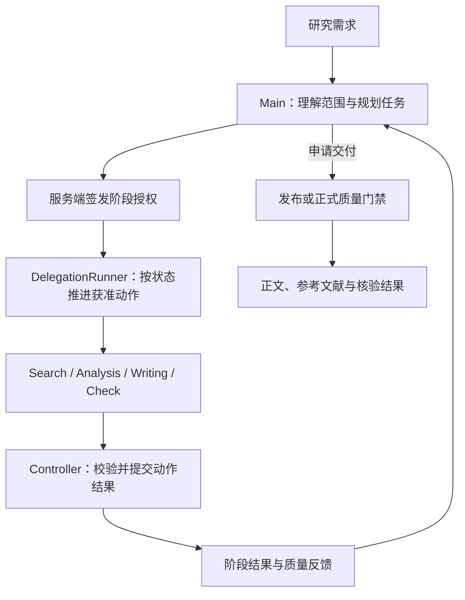

<div align="center">

# ResearchReview-Agent

**从一个研究问题，到一份有据可查的文献综述。**

多源论文检索 · 结构化证据 · 多 Agent 协作 · 引用核验


**中文** | [English](README.en.md)

[快速开始](#快速开始) · [使用示例](#使用示例) · [工作原理](#工作原理) · [文档](#文档)

</div>

ResearchReview-Agent 是一个面向学术文献综述的 AI Agent。输入研究主题、时间范围和写作要求，它会检索论文、整理证据、归纳研究脉络，并生成带参考文献的研究背景、研究现状、相关工作或叙述性综述初稿。

你可以在对话中澄清方向、调整论文集合、继续研究；也可以回查正文中的主张对应哪些论文和原文片段。

## 你可以用它做什么

| 场景 | 输入示例 | 交付内容 |
| --- | --- | --- |
| 了解一个研究方向 | “梳理检索增强生成的主要研究路线” | 研究现状与路线归纳 |
| 撰写研究背景 | “介绍少样本动作识别的问题背景与研究动机” | 研究背景与参考文献 |
| 整理相关工作 | 提供自己的研究问题、方法和创新点 | 围绕本文工作的相关工作章节 |
| 起草文献综述 | 指定主题、年份、语言和引用篇数 | 综述初稿与参考文献 |

## 核心特性

- **多源发现论文** — 联合检索 arXiv、Semantic Scholar、OpenAlex 和 Crossref，合并去重并复核元数据。
- **两层混合检索** — 在论文层筛选相关文献，在全文层检索字段证据；结合 BM25、向量召回、RRF 融合与 Reranker 重排。
- **把论文变成证据** — 解析 PDF，提取研究问题、方法、数据、结果与局限，保留页码和原文位置。采用 PyMuPDF 逐页解析，在检索命中论文后按需构建或复用论文内索引，再按字段检索并抽取证据卡。
- **按任务协作的研究 Agent** — Main 选择阶段能力，Search、Analysis、Writing 和 Check 在各自授权范围内推进工作。每步结果独立提交，Check 发现问题后可定向修订并复验。
- **逐句回查引用** — 将正文主张关联到证据，检查引用身份、语义支持、数字及研究约束。
- **持续研究与修订** — 支持多轮澄清、论文排除、检查点恢复和增量生成，复用已有研究成果。
- **看得见的研究过程** — Streamlit 界面展示任务进度与核验结果，HTML 运行报告记录决策、工具步骤和模型用量。

## 快速开始

### 1. 获取项目并安装依赖

需要 Python 3.11；推荐使用 Conda：

```bash
git clone https://github.com/Pryer/ResearchReview-Agent.git
cd ResearchReview-Agent
conda env create -f environment.yml
conda activate rragent
```

已有 Python 环境也可以直接安装：

```bash
python -m pip install -r requirements.txt
```

### 2. 配置模型与存储

将 `.env.example` 复制为 `.env`，填写以下配置：

| 配置组 | 需要填写的内容 |
| --- | --- |
| 对话与写作模型 | `LLM_PROVIDER`、`LLM_API_KEY`、`LLM_BASE_URL`、`LLM_MODEL`，支持 OpenAI 兼容接口 |
| 检索模型 | `DASHSCOPE_API_KEY`、`RETRIEVAL_EMBEDDING_URL`、`RETRIEVAL_RERANK_URL`，使用百炼原生端点 |
| 向量存储 | 默认 PostgreSQL + pgvector，填写独立的 `CARD_VECTOR_DATABASE_URL` |

业务数据默认保存到 SQLite，全文向量索引使用独立存储。首次使用 pgvector 时，先创建数据库并安装 vector 扩展，再初始化项目表：

```bash
python scripts/manage_vectorstore.py migrate
python scripts/check_rag_runtime.py
python scripts/check_llm_api.py --target primary
```

数据库部署见 [Windows Conda + pgvector](docs/windows-conda-pgvector.md)；后端选项及迁移见 [检索与存储配置](docs/hierarchical-rag-migration.md)。完整配置项见 [.env.example](.env.example)。

### 3. 启动服务

在一个终端启动 API：

```bash
python run_api.py
```

在另一个终端激活相同环境并启动界面：

```bash
conda activate rragent
python run_chat_frontend.py
```

按终端提示打开 Streamlit 界面，输入研究需求即可开始。API 默认端口为 `8000`，前端默认端口为 `8501`，交互式 API 文档位于后端的 `/docs` 路径。

## 使用示例

### 在界面中发起研究

```text
调研 2020—2023 年检索增强生成在开放域问答中的应用，
生成中文研究现状，按研究方法组织，最终引用至少 5 篇不同论文。
```

Agent 会解析研究范围、检索和筛选论文、整理证据，并生成候选正文。你可以在界面查看论文与引用核验结果，再提出修订要求，例如：

```text
删除第 2 篇论文，重点比较不同检索器的作用，重新生成研究现状。
```

### 通过 API 提交任务

向 `POST /api/reviews/jobs` 提交 JSON：

```json
{
  "session_id": "rag-review-demo",
  "user_query": "调研2020—2023年检索增强生成在开放域问答中的应用，生成中文研究现状，引用至少5篇不同论文。",
  "delivery_mode": "draft_first"
}
```

接口返回任务标识后，通过 `GET /api/reviews/jobs/{job_id}` 查询进度和结果。

| 操作 | 接口 |
| --- | --- |
| 发起研究或继续会话 | `POST /api/reviews/jobs` |
| 查询任务进度 | `GET /api/reviews/jobs/{job_id}` |
| 取消任务 | `POST /api/reviews/jobs/{job_id}/cancel` |
| 修改论文集合并重新生成 | `POST /api/reviews/jobs/revise` |
| 读取研究会话 | `GET /api/reviews/sessions/{session_id}` |

默认 `draft_first` 支持先交付带待完善项的草稿，再继续优化；选择 `strict` 可要求通过正式质量门禁后交付。结果会同时给出交付状态与原始要求的满足情况。

更多输入模板见 [examples/](examples/README.md)，包括相关工作、主题澄清与检查点恢复。

## 工作原理



Main 根据当前研究状态选择能力、目标和范围，服务端从能力目录确定角色并签发授权。Search 和 Analysis 可以在一次委派内完成多个获准动作，每一步单独校验和提交。默认采用确定性局部策略，Search 和 Analysis 可开启 ReAct，Analysis 还可选择 Plan-and-Act。Writing 和 Check 使用直接执行路径。

Writing 提交候选后，独立 Check 把核验结果绑定到该版本和证据。Main 可以根据问题定向委派修订，再对新稿复验。重启时，后台 Job 与直接 Python 入口沿用同一套检查点、预算账本和已提交结果。

完整模块与数据流见 [架构介绍](ARCHITECTURE.md)。

## 评测结果

在三个主题、480 条冻结候选的混合来源标签上，RRF＋Reranker 的 Precision@72 为 **94.91%**，Dense 为 **87.04%**，提高 **7.87 个百分点**；Recall@120 分别为 95.43% 和 95.70%。

12 项受控核验案例检出全部 8 项引用/数字错误，4 项原样对照均未误报；确定性检查与加入语义模型的结果一致。指标口径、复现入口及缓存回放结果见 [评测报告](docs/benchmarks.md)。

| v2 验收场景 | 观察结果 |
| --- | --- |
| `rragent` 全量回归 | **2769 项通过**，包含原生 pgvector 集成测试 |
| 真实 HTTP 精确论文检索 | 后台任务完成，保留来源与执行报告 |
| 草稿优先综述 | 一次 `partial` 运行交付可编辑正文，包含 5 篇引用 |
| 严格研究现状复验 | 写作结构通过，完成章节修订、独立复验与主张重建。两条无引证的综合主张触发正式门禁 |

真实综述的独立原文审查仍待完成。运行条件、范围约束及结果见 [v2 验收记录](docs/validation/2026-11-18-v2-live-closeout.md)。

## 文档

| 我想了解… | 阅读入口 |
| --- | --- |
| 系统结构与一次请求的完整路径 | [架构介绍](ARCHITECTURE.md) |
| 前端操作和多轮研究 | [界面指南](docs/CHAT_FRONTEND_GUIDE.md) · [多轮会话](docs/multi_turn_research.md) |
| 检索、模型和向量库配置 | [分层检索配置](docs/hierarchical-rag-migration.md) · [.env.example](.env.example) |
| 论文证据与逐句引用核验 | [证据模型](docs/evidence-model.md) · [主张核验](docs/evidence_verification.md) |
| Agent 的上下文与记忆 | [上下文设计](docs/agent-context-architecture.md) |
| 任务恢复、缓存与预算 | [运行机制](docs/agent-runtime-and-cache.md) |
| 草稿交付与质量反馈 | [交付策略](docs/draft-delivery-and-incremental-retrieval.md) · [Check Agent](docs/check-agent-and-feedback.md) |
| 导出研究执行过程 | [HTML 运行报告](docs/execution-reports.md) |
| 版本变化 | [更新记录](CHANGELOG.md) |

CNKI 可通过 Selenium 适配器接入，由部署方在具备访问授权后显式启用；配置见 [.env.example](.env.example)。

## 开发与贡献

```bash
python -m pytest -q
```

代码位于 `app/`，测试位于 `tests/`，标准请求位于 `examples/`。开发约定见 [AGENTS.md](AGENTS.md)。

欢迎通过 [Issues](https://github.com/Pryer/ResearchReview-Agent/issues) 提交问题、使用反馈和功能建议，也欢迎提交 Pull Request。复现问题时，请附上运行环境、复现步骤和脱敏后的错误信息。
