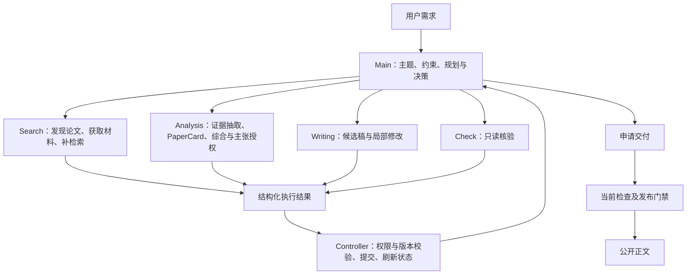

# Check Agent 与 Main 主导反馈闭环

Main 根据用户需求形成主题和硬约束，负责规划、上下文分发和后续决策。Search、Analysis、Writing、Check 同步执行一次获准的专业动作，返回 Main；Controller 管理输入权限、版本、预算和原子提交。

## 统一结果契约

复用 AgentTaskResult，保留三种不同状态：status 表示动作生命周期；outcome 表示本次动作的业务结果；delegation_status 表示向 Main 汇报完成、需要协助或阻断。新增类型化 issues、suggested_actions、check_report_ref。issues 包含问题代码、定位、证据引用、原因、严重程度和可恢复性，建议只能引用注册动作，不授予执行权限。

操作结束与综述交付分别评价。例如 Check 成功执行但发现不受支持的主张：status=completed、outcome=degraded，报告 verdict=needs_revision。Search 找到了材料不会因为旧稿被阻断而被误标为同一次业务失败。普通工具异常保留失败原因并返回 Main；取消、预算耗尽和租约失权继续向执行边界传播。

已有任务结果缺少新字段时按空值读取，历史 Analysis 核验记录不改写。未执行的历史 Analysis 核验委派恢复时转交 Check；已执行的旧委派先返回 Main，再根据当前版本决定是否重新核验。

## 检查、修改与发布

validate_result 改由 Check 持有，核验节点提供 read_only 模式。原有非自主调用保留默认兼容，当前自主生产入口强制只读：Check 不删除、弱化、改写或格式化正文。Writing 在生成结束后完成引用排版，再提交候选。

Check 复用主张授权对齐、语义支持判断、引用与元数据检查、引用授权一致性以及最终质量门禁。它返回 CheckReport，不生成公开答案。报告的 execution_status 区分完成、部分未完成和执行失败；verdict 区分通过、需要修改和无法核验。未完成核验、失败后残留的旧通过记录、含阻断事实问题却宣称通过的结果均不得发布。

CheckReport 绑定正文、稿件版本、证据及来源、主张授权、写作计划、用户约束和检查策略指纹。正文或依赖变化后旧报告失效。报告记录真实检查范围和覆盖，完整问题保存为受角色权限控制的不可变资料；Main 状态栏只加载有界摘要，具体来源由专业角色按契约读取。

Main 决策后调用 request_finish，Controller 复核待核验状态、当前报告、检查是否完成、现有验证指纹和原发布门禁。final_answer_node 复用同版门禁结果组装答案。普通成功和用户明确允许的 partial 都要经过申请交付；Check 不能自行结束任务。

## 恢复与候选保留

- 措辞、引用或结构问题：Main 委派 Writing 修改对应章节，保留未受影响的内容。
- 已有论文尚未提取到材料：Main 委派 Analysis 定向分析。
- 用户要求的必要主题缺少直接证据：Main 选择针对该缺口的补检索，资料准备、Analysis 抽取和授权完成后再交给 Writing。
- 检查暂时失败：Main 可在原预算内重试或调整恢复动作。

Main 接收具体问题和可选章节 ID。Subagent 的建议只是数据，下一项研究动作仍需重新委派。自动生成的非必要主张可在现有证据内缩小或删除，用户明确要求的主题不能被静默删除。

Controller 在检查结果提交后比较候选质量。只有旧稿的检查与当前证据依赖仍匹配，才允许回滚到较优稿；旧稿不存在的字段也必须恢复为缺省，避免继承新稿的引用快照。恢复该稿的原版本与报告，绝不把旧稿通过当成新稿通过。

恢复复用 generation_recovery 的原有账本与预算，不创建第二套调度器。进展继续按材料、证据、主张、候选和验证结果判定，报告 ID 或汇报文字变化不算进展。总模型请求上限 1024、检索独立上限、时间/Token/恢复上限与每篇 8 块抽取预算均按原配置执行。

## 实现与验证入口

核心文件：app/agent/subagents/check_agent.py、app/agent/checking.py、app/schemas/check_schema.py、agent_task_schema.py、action_registry.py、action_contracts.py、controller.py、graph.py、nodes/verification.py、subagents/loop.py 和 app/prompt/agent_system.py。

新增行为回归见 tests/test_check_agent.py。已有真实失败恢复场景见 tests/test_main_quality_loop.py、test_writing_action_boundaries.py、test_context_selection_repair.py。离线模型均为替身，真实 Provider/pgvector E2E 另行记录，不等同于独立人工语义审查。

## 执行模型的任务上下文与恢复归属

Main 的任务目标、参数及已选择摘要不仅进入子Agent决策上下文，也通过执行期 ContextVar 到达该角色的实际模型请求。它是任务数据，不能扩大当前证据授权；不同角色不继承该临时说明，执行结束或异常后恢复原作用域。子Agent的工具理由不能替换Main的任务目标。

新协议任务的Main终态由会话层直接保存，不再由外层恢复器重新安排研究动作；旧会话的原恢复入口保留，用户显式再次恢复仍进入新的Main回合。执行结果已提交后，普通模型汇报错误返回needs_help及原结构化结果，不重放业务工具；余额、预算、取消与失权仍按控制停止处理。
# 2026-11-11 修复目标与事件说明

章节重写只接受当前计划中的章节ID，或能唯一展开的交付物类型。未知或歧义目标不能触发整篇重写。Writer读取完整恢复问题及其证据边界，输出仍只有正文，最终核验由独立Check负责。

失败记忆继续兼容 agent_failure 事件类型，新增 event_category 区分 execution_failed、quality_rejected 与 action_rejected；Main再次接收专业委派汇报时不重复记录已观察的质量失败。该兼容事件类型的条目总数不得直接作为模型调用故障率。
