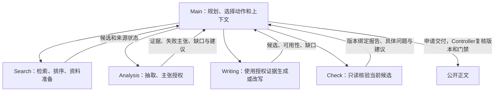

# Main主导的质量恢复闭环

Main负责理解主题和约束、规划与选择下一项委派。Search、Analysis、Writing、Check每次执行本次获准的研究动作，返回结构化结果和完成、协助或阻断状态；同角色的下一项研究动作也由Main重新委派。

这是一组可由Main选择的动作，Controller约束输入、版本和提交权限。不存在子Agent自动调用其他角色或后台并行写共享状态。

## 核验失败后的选择

- 证据足够但表述越界、引用或结构有问题：Main可委派Writing改写指定章节。
- 已有材料不足以支持具体主张：Main先委派Analysis诊断，随后可选择Search定向补检索。
- Search提交的仍是候选。新增论文经过详情补全、Analysis提取与主张授权之后，才可以参与下一版正文。
- 本次操作完成不等于内容可用或可公开。正文残稿、段落或引用不合格时，Writing返回阻断结果和具体错误，不能标记为available。

`state.quality_feedback`是从当前权威结果派生的有界视图，包含候选可用性、字符数、待核验状态、失败主张ID、对应证据ID、失败原因及修复建议。详细原文仍通过资料引用加载，不转发整个对话或其他角色私有轨迹。写作后的旧核验报告明确标记为上一候选的结果。

当前候选通过门禁且可用时，反馈只建议申请最终交付，不再沿用历史恢复建议；最终Controller仍检查当前版本和发布资格。

## 候选版本与结束条件

新正文产生后设置`pending_result_validation`。此时Main可委派Check独立验证或明确报告阻断；诊断、重建主张和继续写作不能跳过本版本核验。Controller直接调用也执行该约束。

独立核验完成后清除待核验状态，按当前版本比较质量；已有的保留较优候选机制继续生效。主控进展指纹同时考虑待核验状态与验证计数，但同一报告重放不会制造进展。

当本次独立核验拒绝退化候选并确认回滚版本有效时，允许Main换一种恢复策略；只有历史回滚记录或验证指纹不匹配时仍按状态循环处理。这个例外仅适用于刚发生的可信回滚，不关闭整个任务的循环检测。

研究操作已原子提交后，如果子Agent在有界纠错后仍无法合法汇报，系统保留真实操作结果与结构化反馈，显式返回needs_help及汇报错误，由Main继续决策。不重放已执行的工具，不增加模型重试；操作尚未执行时的协议失败仍正常传播。

恢复建议和账本复用`generation_recovery`。Main选择的恢复动作单独记录，共享原有预算；Search已预留的本轮恢复不重复扣费。查询绑定诊断时的正文、证据和授权指纹，资料变化后不能复用旧查询。

总Token、模型请求、研究动作、恢复次数、时间、无进展和状态循环限制全部保留。没有获得支持的主张不会因循环而放行；只有当前候选通过最终门禁才允许公开交付。

## 数量储备

最低引用数表示最终正文实际使用的唯一论文数。排序后仅保留通过主题和来源准入的合格候选；普通显式数量任务的检索余量比例由0.8调整为1.0，使候选目标通常达到最低引用要求的2倍。小任务保留至少5篇绝对余量，大任务仍受40篇绝对余量上限约束。

首批详情和证据池仍按约1.5倍引用要求处理，并可根据实际证据和引用损耗扩充。候选量、可用证据量、主张授权量与公开引用量分别记录。数量冗余不能替代逐条主张支持检查，也不会为凑数降低相关性准入。

关键实现：`app/agent/quality_feedback.py`、`action_registry.py`、`main_loop.py`、`graph.py`、`delegation_recovery.py`及`slot_extractor.py`。新增行为回归见`tests/test_main_quality_loop.py`，外部模型在离线测试中均为替身。
# 2026-11-11 轨迹修复补充

门禁汇总负责阻断，逐句核验报告负责定位。恢复诊断从完整逐句报告补齐主张与章节目标，不依赖 Main 摘要中最多展示的弱主张数。仅当前核验报告可派生执行目标，旧报告继续保留为诊断材料。

质量恢复历史记录基础正文版本、目标句、章节及复验结果。跨版本的 cNNN 是句序编号，不能视为稳定身份；只有当前版本的独立复验可以确认修复。未能可靠关联的新旧句标为 unverifiable，不自动算成功。

无进展重写同时绑定证据、授权和质量向量；仅改正文措辞不会重置同类尝试。新证据仍允许重新评估，历史消费和预算不重置。
